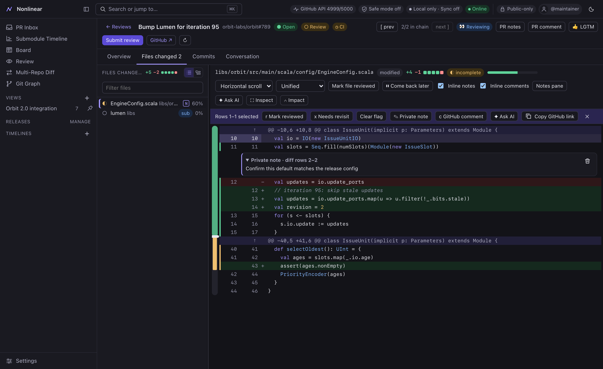
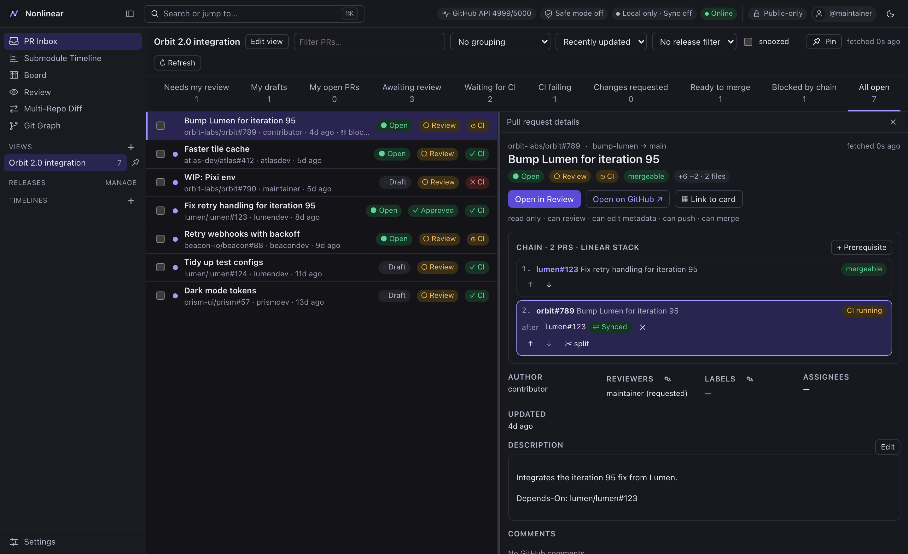
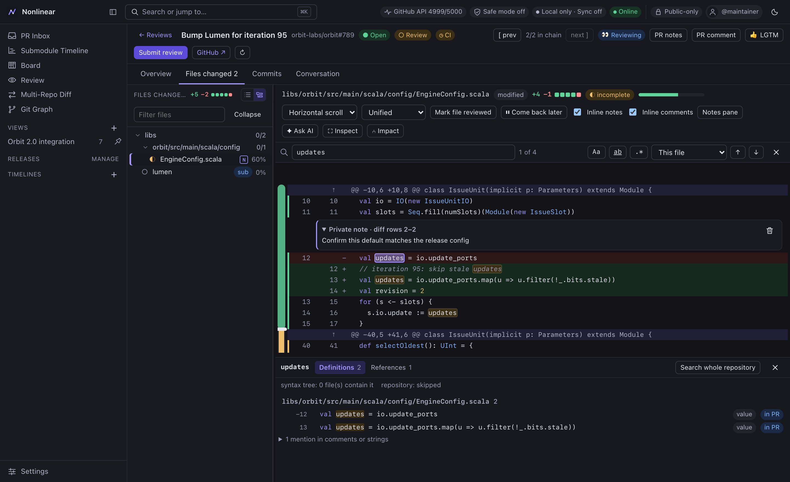
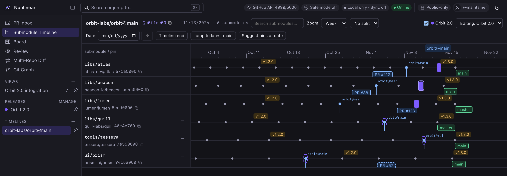
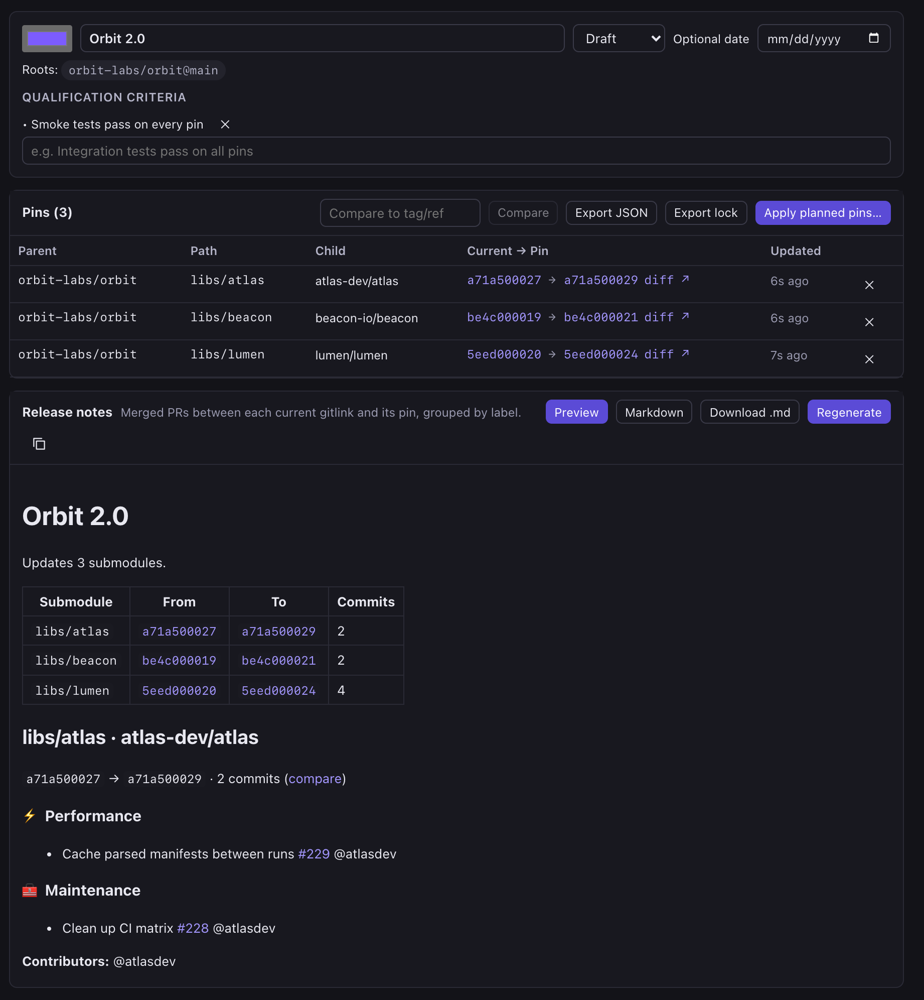
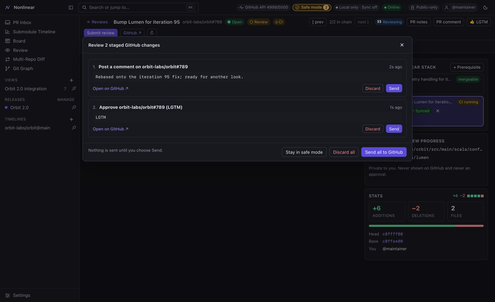
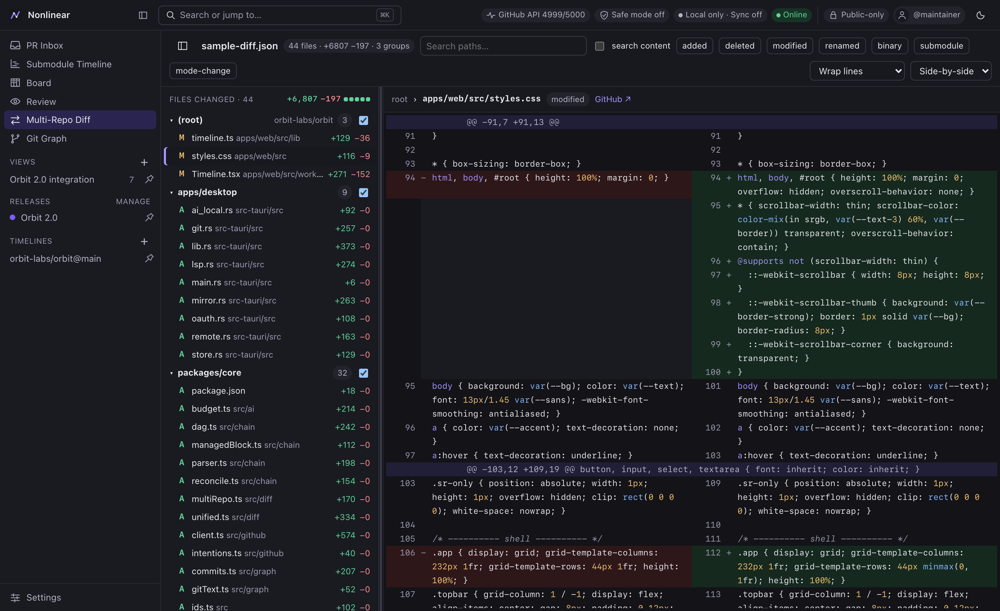
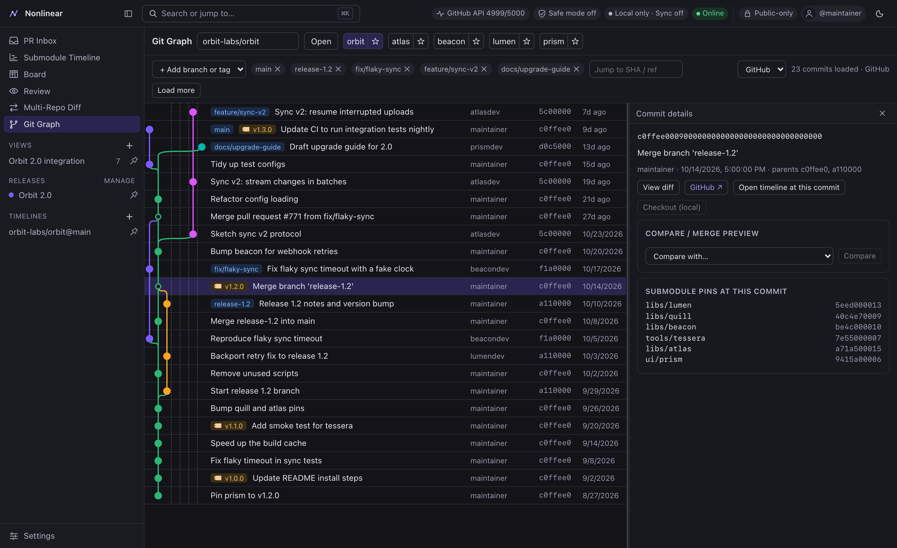
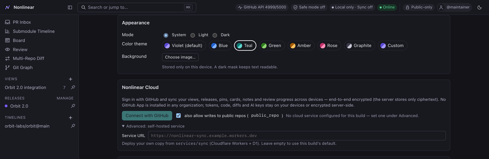

<p align="center">
  
</p>

<h1 align="center">Nonlinear</h1>

<p align="center">
  <strong>The release workbench for maintainers whose work doesn't fit in one repo.</strong><br>
  PR triage, cross-repo dependency chains, submodule pinning and large-diff review, all local-first and GitHub-native.
</p>

<p align="center">
  <a href="#install">Install</a> ·
  <a href="#features">Features</a> ·
  <a href="#privacy--security">Privacy</a> ·
  <a href="#self-hosting-nonlinear-cloud">Self-host</a> ·
  <a href="#development">Develop</a>
</p>

---

Shipping a release across a dozen repositories and nested Git submodules means juggling browser tabs, PRs that depend on each other, and diffs too large to keep in your head. Nonlinear puts all of it in one workspace.

- **No GitHub App to install.** Sign in with your own account. GitHub stays the source of truth for PRs, reviews and permissions.
- **Your notes stay yours.** Review progress, release plans, cards and private notes live on your devices, with optional end-to-end-encrypted sync.
- **Built for real ecosystems.** Designed around the [Chipyard](https://github.com/ucb-bar/chipyard) family of repos, and it works for any multi-repo or submodule-heavy project.

<p align="center">
  
</p>

## Features

### 📥 Inbox: PR triage across every repo
One inbox for every repo you maintain. PRs are sorted into categories you can edit (needs my review, CI failing, blocked by chain, ready to merge…). You can pin, snooze, group by release and see what changed since you last looked.

### 🔗 Dependency chains
Declare `Depends-On: org/repo#123` in a PR body, or build the chain in the UI. Nonlinear builds the DAG, rejects cycles, explains *why* something isn't ready to merge, and keeps a managed chain block up to date in every PR it touches.



### 🔍 Review built for big diffs
- A frontier rail tracks exactly which hunks you've reviewed. Progress follows hunks across force-pushes, and anything that changed since you looked is marked stale.
- Private notes and draft comments appear inline, and you can delete them in place. Drafts post as one GitHub review.
- **Ask AI** about a line or a range of lines from the right-click menu or the toolbar. You see the exact prompt and estimated cost before anything is sent.
- **LGTM** approves in one click. When you start reviewing, Nonlinear requests a review from you, so others see you're on it. GitHub's pending reviews are private, so this is the only visible signal.
- **Go to definition / find references** in any language: ⌘-click an identifier, right-click it, or select it and press F12 / ⇧F12. Results come from the PR's changes, the full changed files (parsed with tree-sitter for Scala, Python, Rust, TypeScript/JavaScript, C, C++ and Java; per-language text rules for Go, Verilog/SystemVerilog, VHDL, Kotlin, Swift, shell and others), the rest of the repository (`git grep` at the PR head on desktop, GitHub code search on the web), and **any LSP server** you configure (clangd, Metals, pyright, rust-analyzer, gopls…), whose results are marked confirmed.
- **⌘F searches the code** once you've clicked in the diff, built for files with hundreds of thousands of lines. Match case, whole word, regex, and an all-changed-files mode with per-file counts.
- Browse changed files as a flat list or a **folder tree**.
- Step through a chain with prev/next, and expand submodule changes inline.



### 🕰 Submodule timeline
Each submodule gets a row on a shared calendar axis, with daily or weekly ticks, showing pins, tags, branch tips and open PRs. Drag release handles to choose commits, or suggest pins at a date. **Timeline end** and **Jump to latest main** move the view without touching your pins.



### 📦 Releases and release notes
Every pin shows the current gitlink → the planned one, linked to GitHub with a compare link. Nonlinear generates release notes from the PRs merged in between, grouped by label like release-drafter. You can edit, copy or download them, export a manifest or lock file, or open a draft PR that bumps every gitlink.

<p align="center"></p>

### 🛡 Safe mode
Turn on safe mode from the top bar and nothing is written to GitHub. Comments, reviews, approvals and chain updates are staged instead. When you leave safe mode, you review them one by one and send or discard each.



### 🧾 Multi-repo diff viewer
Import a JSON diff that spans the root repo and its submodules. A 51 MB, 3,500-file import is indexed in about 280 ms, saved locally, and reopens instantly offline. Use <kbd>j</kbd>/<kbd>k</kbd> to step through files.



### 🌿 Git graph
A lane graph with refs, PRs and the submodule pins at each commit, plus commit diffs, compare and merge previews. Data can come from the GitHub API, your local working tree, a managed partial mirror, or a remote machine over SSH.



### ✨ Optional AI
Bring your own API key, or use a local **Claude Code** or **Codex CLI** install. You see every prompt before it's sent, policies are set per repo, and a hard budget cap stops spending. On desktop you can also share a review selection with your local MCP clients for 30 minutes.

### 🎨 Also included
- Seven color themes or your own custom color, light or dark mode, and an optional background image with a darkness mask.
- A kanban board where cards link PRs, releases and checklists.
- A ⌘K / ⌘P command palette and configurable keybindings; ⌘/ lists every shortcut.
- Backup and restore of all local data, and a full erase of everything the app keeps on the device.
- Offline mode: GitHub writes queue up and wait for your confirmation.
- Automated WCAG 2.2 AA audits report zero violations.



## Install

### macOS app
Download the latest `.dmg` (currently **0.1.14**) from [Releases](https://github.com/jimfangx/Nonlinear/releases), then drag **Nonlinear** into Applications.

> Current builds are Apple Silicon only and ad-hoc signed. The first time you open the app, right-click it and choose **Open**.

The desktop app adds local Git, SQLite storage, the OS keychain, LSP integration, partial repo mirrors and SSH offload.

### Web app
Nonlinear also runs as an installable PWA. Build it from source (see [Development](#development)) and serve `apps/web/dist`.

### Getting started
1. Sign in to GitHub, one of two ways:
   - **With your team's sync server** (see [Self-hosting](#self-hosting-nonlinear-cloud)): open **Settings → Nonlinear Cloud → Advanced**, enter its URL, then click **Connect with GitHub**. This also syncs your data between devices. The app only asks for public-repo scope.
   - **With a personal access token:** paste it under **Settings → GitHub access**. No server needed, but no sync either.
2. Add the repositories you maintain.
3. Start in the **Inbox**.

You can also use Nonlinear without signing in to browse public repositories, but GitHub limits anonymous use to 60 requests per hour.

**Organizations that block OAuth apps:** some organizations only allow OAuth apps an owner has approved, so comments and reviews there fail even though your account has access. Ask an owner to approve your sync server's OAuth App, or add a **fallback personal access token** (from the same account) under **Settings → GitHub access**. Nonlinear then uses that token for just those organizations and keeps the OAuth sign-in everywhere else.

## Privacy & security

- **Local-first.** Everything you create in Nonlinear is stored on your device: IndexedDB in the browser, SQLite on desktop.
- **End-to-end-encrypted sync.** Data is encrypted with AES-GCM before it leaves your device. New devices pair by approval with a matching 6-digit code, or with a recovery key.
- **Minimal GitHub scope.** OAuth requests only `public_repo`, and over-scoped tokens are refused. In the browser, your token never reaches the page.
- **Nothing is sent without you.** Every write to GitHub (chain blocks, labels, reviews, PRs) shows a preview first and needs your confirmation. Safe mode stages all writes until you review them.
- **Erase in one step.** Settings → Local data → Delete local data removes everything the app stores on the device (database, repo mirrors, caches), and optionally your saved tokens and keys. Your own working trees are never touched.

## Self-hosting Nonlinear Cloud

There is no shared Nonlinear Cloud: each team runs its own sync service, a single Cloudflare Worker backed by D1.

1. **Create a GitHub OAuth App** (GitHub → Settings → Developer settings → OAuth Apps). Set the callback URL to `https://<your-worker-host>/auth/github/callback`; you can create it with a placeholder and fix the URL after deploying. Copy the Client ID and generate a client secret.
2. **Create the database:**
   ```sh
   cd services/sync
   npx wrangler login
   npx wrangler d1 create nonlinear
   ```
3. **Edit `services/sync/wrangler.toml`:**
   - `database_id`: the ID printed by `d1 create`
   - `GITHUB_CLIENT_ID`: from step 1
   - `ALLOWED_USERS`: GitHub logins allowed to sign in, comma-separated (empty accepts any account; removing a login also ends that person's sessions)
   - `ALLOWED_ORIGINS`: keep `tauri://localhost` for the desktop app; add your web app's origin if you host one
   - `workers_dev`: set to `true` unless you'll attach a custom domain (otherwise the Worker has no public address)
4. **Create the tables, add the secrets and deploy:**
   ```sh
   npx wrangler d1 migrations apply nonlinear --remote
   npx wrangler secret put GITHUB_CLIENT_SECRET   # from step 1
   npx wrangler secret put TOKEN_KEY              # output of: openssl rand -base64 32
   npx wrangler deploy
   ```
5. **Point the app at it.** Users enter the Worker's URL under **Settings → Nonlinear Cloud → Advanced**. Or build the app with `VITE_NONLINEAR_CLOUD_URL=https://<worker>` so your users get a one-click **Connect** button.

The app only allows sync servers on `*.workers.dev` and the domains listed in its security policy. For a custom domain, add its origin to the CSP in `apps/web/index.html` and `apps/desktop/src-tauri/tauri.conf.json` and rebuild.

## Development

```sh
npm install
npm run dev        # web app at http://localhost:5173
npm test           # core, web and sync-worker tests
npm run desktop    # Tauri desktop app (needs a Rust toolchain)
```

| Path | What |
|---|---|
| `packages/core` | Pure TypeScript domain logic: chains, diff indexing, review intervals, releases, kanban, encrypted op log, GitHub client |
| `apps/web` | React PWA, the shared UI for web and desktop |
| `apps/desktop` | Tauri 2 shell: Git CLI, SQLite, keychain, LSP, SSH helper, OAuth |
| `services/sync` | Cloudflare Worker + D1: OAuth, GitHub proxy, encrypted sync, device pairing |
| `site` | Marketing website (static, deployed to Cloudflare Pages) and the screenshots used here |
| `scripts` | Mock GitHub, end-to-end journeys, accessibility audits, packaging |

Architecture, test suites and handoff notes are in [`design/IMPLEMENTATION_NOTES.md`](design/IMPLEMENTATION_NOTES.md). The full design spec is in [`design/`](design/).

### Running the sync service locally

Sync, sign-in and device pairing can run entirely on your machine against a mock GitHub, so nothing touches real accounts or the deployed service.

**One-time setup:** copy the local settings template and give it an encryption key, then create the local database tables:
```sh
cp services/sync/.dev.vars.example services/sync/.dev.vars    # git-ignored
# set TOKEN_KEY in services/sync/.dev.vars to the output of: openssl rand -base64 32
cd services/sync && npx wrangler d1 migrations apply nonlinear --local
```

**Each session**, in three terminals:
```sh
node scripts/mock-github.mjs 4010      # 1. mock GitHub API + sign-in on :4010
cd services/sync && npm run dev        # 2. sync Worker on http://localhost:8787
npm run dev                            # 3. web app on http://localhost:5173
```
Then in the app open **Settings → Nonlinear Cloud → Advanced**, enter `http://localhost:8787` as the service URL, and click **Connect with GitHub**. The mock signs you in as `maintainer`.

To sign in with real GitHub accounts locally instead, create a separate OAuth App with the callback `http://localhost:8787/auth/github/callback` and switch to option 2 in `.dev.vars`.

### Building the macOS installer

```sh
npm ci
APPLE_SIGNING_IDENTITY=- npm run build -w @nonlinear/desktop -- --bundles app
scripts/make-dmg.sh
```

### Deploying the website

`site/` is plain static files (no build step) served by Cloudflare Pages; `site/_headers` sets security and cache headers.
```sh
npx wrangler pages deploy site --project-name nonlinear-site
```
Or connect the repository in the Cloudflare dashboard with **Build command** empty and **Build output directory** `site`. The site is served at **https://nonlinear.cx** (add it under the Pages project's **Custom domains**); if the domain changes, update the canonical and Open Graph URLs and the JSON-LD block in `site/index.html`, plus `site/robots.txt` and `site/sitemap.xml`.

## License

[MIT](LICENSE)
